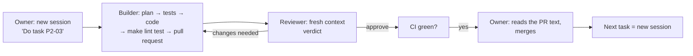

# How to run the build

For the owner. The [build plan](build-plan.md) says **what** is built and in which order. This document says **how to organise the work**: where the repository lives, which agent does what, what one working session looks like, and what the owner must do herself.

## 1. The idea in five lines

1. One task = one fresh agent session = one small pull request.
2. The agent that writes the code never approves its own work. A second agent with a clean context reviews it; CI checks it; the owner merges it.
3. Only one agent writes code at a time. More agents at once give merge conflicts and work nobody understands.
4. Few roles. A role exists only when it needs a different context, different permissions or a different way of thinking.
5. The owner decides at phase gates and human gates. Between gates she does not need to read every line.

## 2. Before the first session

| Step | Why |
|---|---|
| Create the repository in a normal local folder, for example `~/Documents/projects/ai-support-hub`. **Not inside Google Drive.** | A synced folder breaks `.git`, `node_modules` and virtual environments. |
| Copy the content of this `repo/` folder into it, `git init`, first commit, push to a new **private** GitHub repository. Make it public in phase 12. | Human gate H1. |
| Protect `main`: changes only through pull requests, CI must be green. | The agent cannot push broken code to `main`. |
| API keys go only into the local `.env` file and into GitHub repository secrets. Never paste a key into a chat with an agent. | Keys in a chat end up in transcripts. |
| Set a monthly spending limit in the Anthropic and OpenAI consoles (for example $30). | The build makes real model calls from phase 3. |
| Permissions of the coding agent: allow `make`, `uv`, `pnpm`, `git`, `gh`, `docker compose`; deny reading `.env`; do not use the mode that skips all permission prompts. | The agent can work without asking for every command, but cannot read secrets or do something unexpected. |

## 3. Roles

| Role | Who | Does | Does not |
|---|---|---|---|
| **Owner** | Viktoriia | Starts sessions, merges pull requests, does the human gates (H1–H9), reads the walkthrough, gives the go-ahead for the next phase, makes all risk decisions. | Write code during the build. |
| **Builder** | Main session of the coding agent. Its rules are `AGENTS.md`. | Takes one task from the build plan, writes tests and code, opens a pull request, fixes review findings. Writes the phase walkthrough. | Merge. Start the next task or phase on its own. Review itself. |
| **Reviewer** | Subagent [`reviewer`](../.claude/agents/reviewer.md), read-only | Checks the pull request against the task, the documents and the never-do rules. Runs the checks again. Gives a verdict. | Edit files. |
| **Content author** | Subagent [`content-author`](../.claude/agents/content-author.md) | Writes knowledge-base articles, seed data, draft evaluation tickets and attack cases from the world file. | Write application code. Invent facts. |
| **Eval analyst** | Subagent [`eval-analyst`](../.claude/agents/eval-analyst.md), read-only | Reads evaluation results, sorts failures into categories, proposes the next experiment. | Change prompts, code or data. Run paid evaluations. |

Why these and not more:
- **Reviewer** — the builder's context is full of its own reasoning, so it sees what it meant, not what it wrote. A fresh context finds different errors. This is the most useful role after the builder.
- **Content author** — about half of the project's value is in the data (50 articles, 300 tickets, 60 attacks). It needs a different instruction ("only facts from the world file", "sound like a real customer") and would fill the builder's context with text.
- **Eval analyst** — reading 30 failed tickets is slow, careful work with a different goal than building. It also keeps the "do not fix what you measure in the same breath" rule.
- **No separate architect, tester, security or front-end agents.** The architecture is already decided in the documents. Tests belong to the task that needs them. Security rules are in `AGENTS.md` and are checked by the reviewer. The web app is built by the same builder in phase 10.

## 4. One task, step by step

**Start prompt for the builder** (the same every time, only the task id changes):

> Read AGENTS.md. Do task P2-03 from docs/build-plan.md, and nothing else. First show me a short plan: files you will touch, tests you will add, library documentation you will check. Wait for my OK. When the code is ready, open a pull request with the template, then stop.

**Review prompt** (new session, or from the same session after the pull request is open):

> Use the reviewer subagent to review the pull request for task P2-03.

**Rules for sessions**
- A new session for every task. The repository and the documents are the memory, not the chat. A long session gets worse and more expensive.
- Size S and M tasks fit in one session. For an L task ask the builder to split it into two or three pull requests in its plan.
- If the reviewer says "changes needed", give its report to the builder unchanged. Maximum two rounds; if the third round is needed, stop and look at the problem yourself — usually the task or a document is unclear.
- If the builder says a requirement cannot be met or two documents disagree, it must stop. Decide, fix the document first, then continue.
- Content tasks (P2-05, P2-08, P4-02, P8-01, P11-01): the prompt is "Use the content-author subagent for task P2-08". After the owner's check the builder only wires the data in.
- After each `make eval`: "Use the eval-analyst subagent for run <id>". Then the owner chooses the next experiment.

## 5. What the owner looks at

**Per pull request (5–10 minutes).** Do not try to read all the code now.
1. The pull-request text: what changed, the pasted output of the "Verify" command, what the builder was unsure about.
2. The reviewer's verdict and its "Not verified" list.
3. CI is green.
4. One look at the list of changed files: is anything there that does not belong to the task?
5. Always read the full diff yourself when the change is in `guardrails/`, `config/policy.yaml`, `tools/permissions.py`, `auth/` or a prompt file. These files decide what the system is allowed to do.

**Per phase (1–2 hours).**
1. Read `docs/walkthrough/phase-N.md` and answer its five questions before you look at the answers.
2. Run the phase gate check from the build plan yourself, by hand, in the running system.
3. Write three lines into the dev log: what was built, what surprised you, what you do not understand yet.
4. Only then tell the builder to start the next phase.

**Human gates** cannot be given to an agent. The biggest ones: checking every evaluation ticket (H4, plan several evenings), labelling 60 answers for the judge (H5), choosing the confidence threshold (H7).

## 6. Working in parallel

Default: no parallel work. Two exceptions:

| What | How |
|---|---|
| Content tasks while the builder codes | The content author writes only in `data/`, the builder does not touch `data/` at that time. |
| Web tasks P10-01 to P10-04 during phases 8 and 9 | A second builder session in its own git worktree and branch; it touches only `apps/web/`. |

Do not start an agent team that builds a whole phase without stops. The phase gates are the place where errors are still cheap.

## 7. Money and limits

| Cost | Where it comes from | Control |
|---|---|---|
| Coding agent | Your subscription or API use | One task per session; fresh sessions; subagents only for the three roles above. |
| Model calls of the project | Tests use the fake mode and cost nothing. Paid: `make eval*`, `make record-llm`, manual runs with real keys, the demo. | `EVAL_MAX_COST_USD`, the daily budget guard, the provider spending limit. Only the owner starts a full evaluation. |
| Cloud | Phase 10 | Free plans; budget alert in Google Cloud. |

## 8. When something goes wrong

| Sign | What to do |
|---|---|
| The builder changes a test, a rule or a red line to make CI green | Reject the pull request. This is never-do rule 6. |
| The builder uses a library call that does not exist | Ask it to open the documentation of the pinned version and quote the part it uses. |
| The same bug comes back, or the session goes in circles | Stop the session. Start a new one with a short description of the bug and what was already tried. |
| A pull request is much bigger than the task | Do not merge. Ask for a split. |
| The code and a document disagree after a merge | Decide which is right. A changed decision needs a new ADR. Stale documents make every later session worse. |
| An evaluation number looks too good | Check for test-set leakage and for a judge that agrees with everything. Ask the eval analyst for 10 "passed" tickets to read. |
