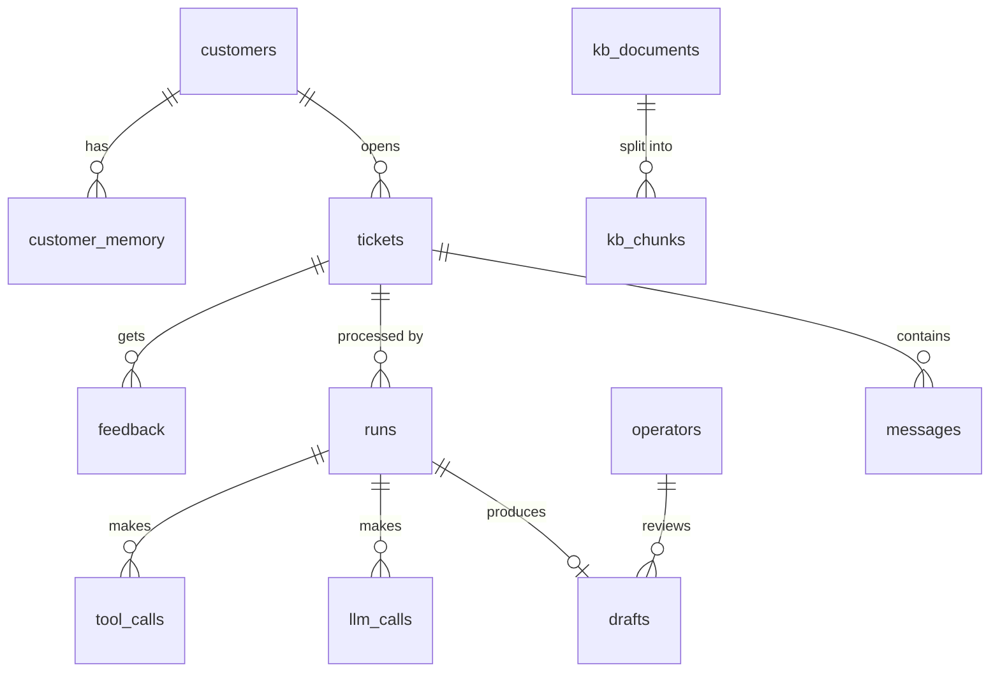
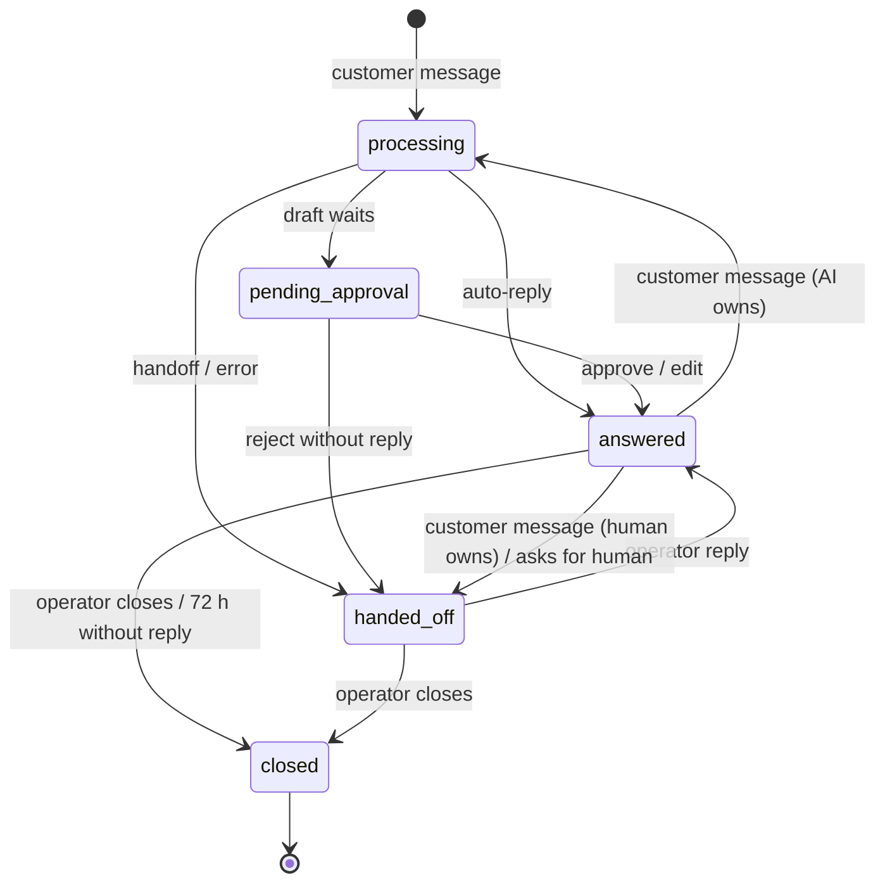

# Data Model

Three kinds of data: the Postgres database (system of record), the Qdrant collection (search index, can always be rebuilt), and files in `data/` (knowledge base, seed data, evaluation sets).

## 1. Postgres

Conventions: `snake_case`; primary keys are UUID v7 (`id`) unless noted (generated in the application; the Python 3.13 standard library has no `uuid7`, so the builder picks a small library or the database function if the Postgres version has one); all timestamps are `timestamptz` in UTC; enums are stored as text with a `CHECK` constraint; every table has `created_at`. Migrations: Alembic, one migration per change, never edit an applied migration.



### customers
Mirror of the demo customers from the core mock. Only what the Hub needs.

| Column | Type | Note |
|---|---|---|
| id | uuid PK | |
| external_ref | text unique | id in the core system, e.g. `CUS-0007` |
| display_name | text | |
| email | text | |
| tier | text | `starter` \| `verified` \| `business` |
| country | text | ISO 3166-1 alpha-2 |
| anonymised_at | timestamptz null | set by erasure |

### operators

| Column | Type | Note |
|---|---|---|
| id | uuid PK | |
| email | text unique | |
| name | text | |
| password_hash | text | Argon2id |
| role | text | `operator` \| `lead` \| `compliance` \| `admin` |
| is_active | bool | |
| last_login_at | timestamptz null | |

### tickets

| Column | Type | Note |
|---|---|---|
| id | uuid PK | also the LangGraph `thread_id` |
| customer_id | uuid FK | |
| channel | text | `chat` |
| status | text | `processing` \| `pending_approval` \| `handed_off` \| `answered` \| `closed` |
| intent | text null | one of the 12 intents |
| secondary_intent | text null | |
| urgency | text null | `low` \| `normal` \| `high` |
| language | text null | ISO 639-1 |
| summary | text null | written by triage, shown to the operator |
| last_route | text null | `auto_reply` \| `approval` \| `handoff` |
| route_reasons | jsonb | list of reason codes, see [ai-pipeline](ai-pipeline.md) §6 |
| confidence | numeric(4,3) null | |
| assigned_operator_id | uuid FK null | |
| ai_disclosed_at | timestamptz | when the AI notice was shown |
| first_response_at, resolved_at | timestamptz null | |
| resolution | text null | `ai` \| `ai_approved` \| `ai_edited` \| `human` |
| version | int | optimistic lock, incremented on every change |

Indexes: `(status, urgency, created_at)`, `(customer_id, created_at)`, `(assigned_operator_id, status)`.

Status transitions (anything else is an error):



Ownership rule: after the first handoff or approval in a ticket, a human owns the ticket. New customer messages do not start a new AI run; they appear in the operator queue.

Closing: an operator closes a ticket by hand, or the scheduled job `close-stale` closes `answered` tickets after 72 h without a customer message. Closing writes the memory summary ([ai-pipeline](ai-pipeline.md) §9).

### messages

| Column | Type | Note |
|---|---|---|
| id | uuid PK | |
| ticket_id | uuid FK | |
| role | text | `customer` \| `assistant` \| `operator` \| `system` |
| body | text | card data already masked; never the raw text |
| is_ai_generated | bool | drives the label in the UI |
| author_operator_id | uuid FK null | |
| run_id | uuid FK null | the foreign key is added with the `runs` table (phase 6) |
| citations | jsonb | `[{"marker": 1, "chunk_id": "...", "doc_id": "...", "title": "...", "url": "..."}]` |
| masked_entities | jsonb | counts by type only, e.g. `{"PAN": 1}` |
| idempotency_key | text null unique | |

### runs
One execution of the workflow for one customer message.

| Column | Type | Note |
|---|---|---|
| id | uuid PK | |
| ticket_id | uuid FK | |
| trigger_message_id | uuid FK | |
| status | text | `running` \| `interrupted` \| `completed` \| `failed` |
| route | text null | |
| route_reasons | jsonb | |
| confidence | numeric(4,3) null | |
| features | jsonb | inputs of the confidence model |
| graph_version | text | git SHA or semantic version of the workflow |
| prompt_versions | jsonb | `{"triage": "v2", "write": "v3", ...}` |
| models | jsonb | role → model id used |
| total_cost_usd | numeric(10,6) | sum of `llm_calls` |
| input_tokens, output_tokens | int | |
| latency_ms | int null | until the customer got a message |
| error | text null | |
| trace_id | text null | Langfuse trace |
| started_at, finished_at | timestamptz | |

### drafts

| Column | Type | Note |
|---|---|---|
| id | uuid PK | |
| run_id | uuid FK unique | |
| ticket_id | uuid FK | |
| body | text | AI draft |
| citations | jsonb | |
| evidence | jsonb | retrieved chunks (id, title, section, score, text) and account facts shown to the operator |
| proposed_actions | jsonb | `[{"type": "jira_create_issue", "params": {...}}]` |
| groundedness | numeric(4,3) null | |
| unsupported_claims | jsonb | from the verify step |
| status | text | `pending` \| `approved` \| `edited` \| `rejected` \| `superseded` (the operator answered with a free reply or closed the ticket without using the draft) |
| reviewed_by | uuid FK null | |
| reviewed_at | timestamptz null | |
| final_body | text null | what was sent |
| edit_ratio | numeric(4,3) null | normalised edit distance between `body` and `final_body` |
| reject_reason | text null | `wrong_facts` \| `wrong_tone` \| `missing_info` \| `policy` \| `other` |
| reject_note | text null | |

### llm_calls
Own record of every model call. Source of truth for cost.

| Column | Type | Note |
|---|---|---|
| id | uuid PK | |
| run_id | uuid FK null | null for eval judges and background calls |
| context | text | `online` \| `eval` \| `memory` |
| node | text | `triage`, `research`, `write`, `verify`, `handoff_prep`, `memory_summary`, `judge` |
| model | text | provider model id |
| prompt_version | text | |
| input_tokens, output_tokens, cached_tokens | int | |
| cost_usd | numeric(10,6) | from `config/pricing.yaml` |
| latency_ms | int | |
| status | text | `ok` \| `retry` \| `error` \| `invalid_output` |
| error | text null | |

Request and response bodies are **not** stored here. They are in the trace (masked, 30 days).

### tool_calls

| Column | Type | Note |
|---|---|---|
| id | uuid PK | |
| run_id | uuid FK | |
| tool | text | e.g. `core_get_transaction` |
| arguments | jsonb | masked |
| result_summary | text | short, masked |
| status | text | `ok` \| `error` \| `denied` |
| side_effect | bool | true for Jira and Slack |
| approved_by | uuid FK null | operator for approved actions |
| idempotency_key | text null unique | |
| external_ref | text null | e.g. Jira key |
| latency_ms | int | |

### customer_memory

| Column | Type | Note |
|---|---|---|
| id | uuid PK | |
| customer_id | uuid FK | |
| ticket_id | uuid FK | |
| kind | text | `ticket_summary` |
| content | text | max 400 characters, masked, no card data, no compliance reasons |
| expires_at | timestamptz | default: created + 12 months |

### feedback

| Column | Type | Note |
|---|---|---|
| id | uuid PK | |
| ticket_id, message_id | uuid FK | |
| rating | text | `up` \| `down` |
| comment | text null | masked |

### kb_documents and kb_chunks
Postgres keeps the knowledge base as the source of truth for the index and for the operator UI.

| kb_documents | Type | Note |
|---|---|---|
| id | text PK | slug from the file name, e.g. `withdrawal-times` |
| title | text | |
| product | text | `account` \| `payment_requests` \| `withdrawals` \| `card` \| `verification` \| `security` \| `fees` \| `general` |
| visibility | text | `external` \| `internal` |
| intents | jsonb | related intents |
| url | text | public help-centre URL (demo: `/help/<id>`) |
| content_hash | text | SHA-256 of the file |
| version | int | +1 when the hash changes |
| updated_at | timestamptz | from front matter |

| kb_chunks | Type | Note |
|---|---|---|
| id | text PK | `<doc_id>#<ordinal>`, e.g. `withdrawal-times#2` |
| doc_id | text FK | |
| ordinal | int | |
| section | text | heading path |
| text | text | |
| token_count | int | |
| content_hash | text | |

### settings
Key-value table for runtime settings changed from the console: `auto_reply_enabled` (bool), `confidence_threshold` (number), `daily_budget_usd` (number), `intent_allowlist` (list). Every change writes an audit record.

| Column | Type | Note |
|---|---|---|
| key | text PK | one of the four names above (`CHECK`) |
| value | jsonb | |
| created_at | timestamptz | |
| updated_at | timestamptz | |

### audit_log
Append-only. The application database role (`hub_app`, [operations](operations.md) §2) has only `INSERT` and `SELECT` on this table.

| Column | Type | Note |
|---|---|---|
| id | bigserial PK | |
| ts | timestamptz | the `created_at` of this table |
| actor_type | text | `ai` \| `operator` \| `customer` \| `system` |
| actor_id | text null | operator id, customer id or run id |
| action | text | e.g. `route.decided`, `draft.approved`, `tool.called`, `auth.login`, `settings.changed`, `customer.erased` |
| entity_type, entity_id | text | |
| details | jsonb | ids, codes and numbers only — no names, no message text, no email |
| prev_hash, hash | text | `hash = sha256(prev_hash + canonical_json(row))` — a broken chain shows tampering |

Two rules that keep the log usable. (1) Inserts are serialised (a Postgres advisory lock around "read last hash → insert"), otherwise two requests at the same time break the chain. (2) The log refers to a customer only by the internal UUID. Erasure anonymises the `customers` row, so the UUID no longer points to a person and no audit row has to change.

**Hash details** (`hub/audit/chain.py`). `canonical_json(row)` covers every column except `id`, `prev_hash` and `hash`: JSON with sorted keys, no spaces, ASCII only, `ts` in UTC with microseconds. `id` is assigned by the database on insert, so it is not known when the hash is computed; the order of rows is protected by `prev_hash`. The first row has `prev_hash` = 64 zeros. Before hashing and storing, every text field (`actor_id`, `action`, `entity_type`, `entity_id`) and every string and number in `details`, keys included, is masked (G1); a number is checked as the decimal text `jsonb` stores for it, so `4111111111111111.0` is masked too. Only `uuid.UUID` objects are kept unmasked (as their text), because masking changes about 1 in 100 UUIDs; callers pass ids as UUID objects. A string is always masked, even one shaped like a UUID, because such a string can hold a card number (`41111111-1111-1111-abcd-…`). Two `details` keys that are the same after masking are refused. `jsonb` stores the decimal text that is written for a number and prints it without exponent notation: the float `1e23` is written as `1e+23` and comes back as `100000000000000000000000`, which differs from the float's exact binary value. A decimal number with a whole value is therefore hashed as the integer of its decimal text; otherwise `verify_chain()` would report rows nobody changed. Only JSON types are accepted; NaN, infinity, NUL characters and invalid Unicode (lone surrogates) are refused with `AuditValueError`, because Postgres refuses them.

### LangGraph checkpoint tables
Created by `langgraph-checkpoint-postgres` (`setup()` in a migration step). Do not edit by hand. Checkpoints of closed tickets are deleted by the retention job.

## 2. Qdrant

Collection `kb_chunks_v1` (alias `kb_chunks`; a re-index builds `v2` and moves the alias).

| Item | Value |
|---|---|
| Point id | UUID v5 of the chunk id |
| Vector `dense` | size from the embedding model in `config/models.yaml`, cosine distance |
| Vector `sparse` | BM25 from FastEmbed, IDF modifier on |
| Payload | `chunk_id`, `doc_id`, `title`, `section`, `text`, `visibility`, `product`, `intents`, `url`, `doc_version` |
| Payload indexes | `visibility` (keyword), `product` (keyword), `doc_id` (keyword) |

Queries use the Query API: two prefetches (dense top 20, sparse top 20), RRF fusion, filter on `visibility`, final top 6.

## 3. Files in `data/`

### `data/kb/*.md` — knowledge-base articles (about 50)

```markdown
---
id: withdrawal-times
title: How long does a withdrawal take?
product: withdrawals
visibility: external
intents: [withdrawal_issue]
updated_at: 2026-10-01
---
## SEPA withdrawals
...
## SWIFT withdrawals
...
```

Rules: one topic per article; 150–600 words; `##` sections that make sense alone; every number comes from [the world file](tallybridge-world.md); about 10 articles are `internal` (operator procedures, escalation rules, compliance wording). `error_codes.csv` has the columns `code, title, customer_explanation, customer_action, visibility` — each row becomes one chunk.

### `data/seed/` — demo data
`customers.json`, `cards.json`, `transactions.json` (40 customers, 5–40 transactions each, including pending, failed-with-error-code and under-review cases), `operators.json` (demo operators, one per role; passwords come from `SEED_OPERATOR_PASSWORD`, not from the file). Each file is a JSON array. The schemas (Pydantic, unknown fields refused) and the rules across files are in `hub/domain/seed.py`; `make data-check` runs them.

| File | Fields |
|---|---|
| `customers.json` | `external_ref` (`CUS-0001`), `display_name`, `email` (`@example.com`), `tier`, `country`, `opened_at`, `balances` (`{"EUR": "1250.00"}`), `restricted`, `restriction_reason` (internal), `upgrade` (verification for a higher tier: `target_tier`, `status` `pending`\|`rejected`, `submitted_at`, `error_code`), `support_scenarios` |
| `cards.json` | `card_ref` (`CRD-0001`), `customer_ref`, `kind` `virtual`\|`physical`, `last4`, `status` `active`\|`frozen`\|`pin_blocked`\|`cancelled`, `issued_at`, `delivery_status` `ordered`\|`shipped`\|`delivered` and `delivery_method` `standard`\|`express` (physical only) |
| `transactions.json` | `reference` (`TX-000001`), `customer_ref`, `type`, `amount`, `currency`, `fee`, `status` `pending`\|`held_for_review`\|`completed`\|`failed`\|`returned`, `error_code`, `requested_at`, `status_history` (`[{status, at}]`), `counterparty`, `card_ref` and `merchant_category` (card use only) |
| `operators.json` | `email` (`@tallybridge.example`), `name`, `role` |

Rules that matter outside the schema:
- Amounts are JSON strings with two decimals (exact, no float rounding).
- Cards hold only the last 4 digits, never a full card number (no tool returns more). No text in a seed file may look like card data; `make data-check` scans every value with the masking code.
- Every customer has finished the checks of their current tier (an account without them cannot hold money, world file §3); verification cases are upgrades to a higher tier.
- **`support_scenarios` is test-data metadata only.** It lists the intents that the customer's data fits, so `make data-check` can prove that each of the 12 intents has at least 3 customers. **It must never reach a model:** no tool result, prompt, memory or evaluation input may contain it, because it would leak the expected intent into evaluation. The core adapter (P7) drops it, like `restriction_reason`.

Dates in seed files are **offsets** from an anchor date (`"requested_at": "-3d 10:15"`: days, then a time of day in **UTC**). The core mock resolves them against `CORE_ANCHOR_DATE`: empty = today (the demo always has a "withdrawal from three days ago"), a fixed date in tests and evaluation (repeatable results). Because the anchor can be any weekday and either side of the summer-time change, scenario dates are chosen to stay true for every anchor: "late" cases lie far enough back to be late on any weekday (late SWIFT at 14 days or more), and a SEPA withdrawal is never requested between 13:00 and 13:59 UTC, the hour that is before the 15:00 CET cut-off in winter but after it in summer (CEST).

### `data/eval/` — evaluation sets
See [eval plan](eval-plan.md) §3 for the schemas of `tickets.dev.jsonl`, `tickets.test.jsonl`, `attacks.jsonl` and `judge_validation.jsonl`.
