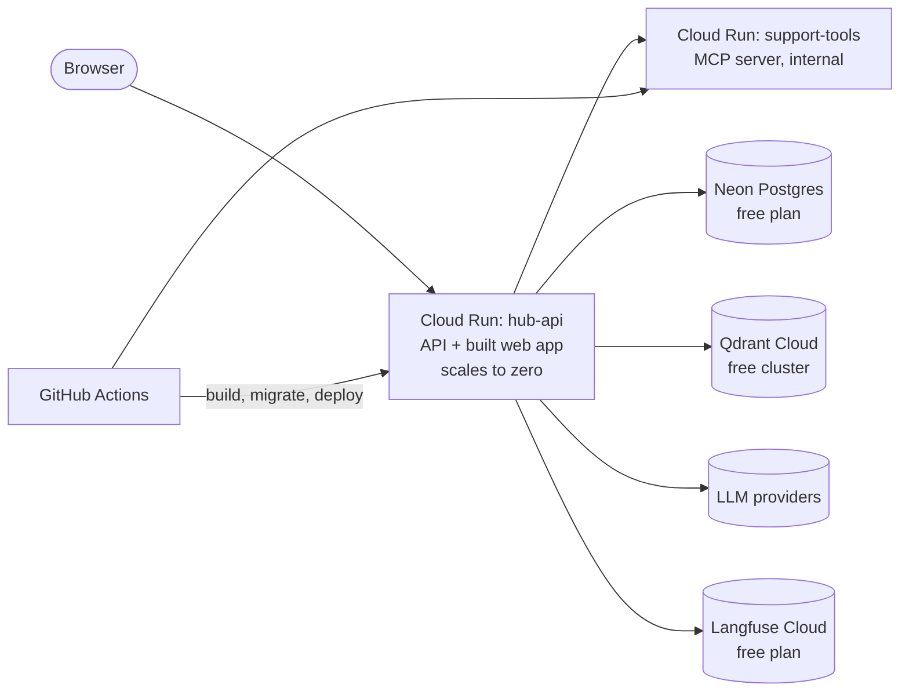

# Operations: local setup, configuration, observability, CI/CD, deployment

## 1. Local development

Requirements: Docker, Python 3.13 with `uv`, Node.js LTS with `pnpm`, `make`.

`infra/docker-compose.yml` services: `postgres`, `qdrant`, `api` (hot reload), `mcp` (support-tools server), `web` (Vite dev server). Optional profile `tracing`: self-hosted Langfuse — only if the cloud free tier is not used.

| Command | Does |
|---|---|
| `make setup` | `uv sync`, `pnpm install`, copy `.env.example` → `.env` if missing, install pre-commit hooks |
| `make up` / `make down` | start / stop the compose stack |
| `make migrate` | Alembic upgrade + LangGraph checkpointer setup |
| `make seed` | load demo customers, operators, settings |
| `make kb-load` | load `data/kb` into Postgres and Qdrant (only changed documents) |
| `make dev` | `up` + `migrate` + `seed` + `kb-load` |
| `make test` | unit tests (no network, no containers) |
| `make test-int` | integration tests with testcontainers (Postgres, Qdrant) and recorded model responses |
| `make test-e2e` | Playwright against the compose stack with the fake model provider |
| `make lint` | ruff, mypy, import-linter, eslint, tsc |
| `make data-check` | validate `data/` |
| `make eval SPLIT=dev`, `make eval-smoke`, `make eval-attacks` | see [eval plan](eval-plan.md) |
| `make web-types` | generate TypeScript types from OpenAPI |
| `make retention` | run the retention job once |
| `make record-llm` | refresh recorded model responses for tests (real calls) |
| `make eval-judges` | measure the judges against the human-labelled validation set |
| `make leak-scan` | scan database, logs and recorded model requests for card patterns and canary strings |
| `make export-review-candidates` | export rejected and heavily edited drafts as candidates for new eval tickets |
| `make rollback` | send traffic back to the previous deployed revision |

**Fake model provider.** `LLM_MODE=fake` makes the gateway return deterministic recorded or scripted responses. Unit, integration and e2e tests run with it, so tests need no API key and cost nothing. Recordings live in `apps/api/tests/fixtures/llm/` and are refreshed with `make record-llm` (real calls).

## 2. Configuration

All settings are environment variables read by one Pydantic `Settings` class (`hub/config.py`). `.env.example` lists every variable with a comment. No setting is read anywhere else.

| Variable | Example | Note |
|---|---|---|
| `APP_ENV` | `local` \| `test` \| `demo` | |
| `DATABASE_URL` | `postgresql+psycopg://…` | |
| `DATABASE_URL_DIRECT` | | direct (not pooled) connection for migrations and checkpointer setup; empty = same as `DATABASE_URL` |
| `EVAL_DATABASE_URL` | | separate database for evaluation runs |
| `CORE_ANCHOR_DATE` | empty \| `2026-11-12` | "today" for the core mock and the workflow; empty = real date; fixed in tests and evaluation |
| `JOBS_TOKEN` | random | bearer token for `POST /admin/jobs/*` |
| `QDRANT_URL`, `QDRANT_API_KEY` | | key empty locally |
| `ANTHROPIC_API_KEY`, `OPENAI_API_KEY` | | read by LiteLLM |
| `LLM_MODE` | `real` \| `fake` | |
| `MODELS_CONFIG` | `config/models.yaml` | |
| `MCP_SERVER_URL`, `MCP_SERVER_TOKEN` | `http://mcp:8001/mcp` | |
| `JIRA_MODE`, `SLACK_MODE` | `mock` \| `real` | plus `JIRA_BASE_URL`, `JIRA_EMAIL`, `JIRA_API_TOKEN`, `JIRA_PROJECT_KEY`, `SLACK_BOT_TOKEN`, `SLACK_CHANNEL_ID` |
| `SESSION_SECRET` | random 32 bytes | |
| `DEMO_ACCESS_CODE` | | for the public chat |
| `SEED_OPERATOR_PASSWORD` | | used by `make seed` |
| `LANGFUSE_PUBLIC_KEY`, `LANGFUSE_SECRET_KEY`, `LANGFUSE_HOST` | | tracing is off when empty |
| `DAILY_BUDGET_USD` | `3.0` | start value of the setting |
| `EVAL_MAX_COST_USD` | `8.0` | |
| `EVAL_TRACE_SAMPLE` | `0.2` | share of evaluation runs sent to Langfuse |
| `LOG_LEVEL` | `INFO` | |

Runtime settings that the lead changes in the console (auto-reply, threshold, budget, allow-list) live in the `settings` table; environment variables give only the first values.

## 3. Observability

**Three layers, each with one job.**

| Layer | Tool | Answers the question |
|---|---|---|
| Structured logs | `structlog`, JSON to stdout, masked | What happened in the service? Each line has `ticket_id`, `run_id`, `node`, `request_id`. |
| Traces | Langfuse via OpenTelemetry | What did this run do, step by step? One trace per run; one span per node; one generation per model call (masked input and output, tokens, cost, prompt version); spans for retrieval (query, chunk ids, scores) and tool calls. Trace id stored in `runs.trace_id`; the console links to it. |
| Business and cost data | Postgres: `runs`, `llm_calls`, `drafts`, `feedback` | How is the service doing? Source for the dashboard and for cost. Does not depend on the tracing vendor. |

Trace attributes on every run: `ticket_id`, `intent`, `route`, `route_reasons`, `confidence`, `graph_version`, `prompt_versions`, `variant`, `context` (`online` / `eval`). Eval runs are traced with the tag `eval` and the run id, so a bad eval ticket can be opened as a trace.

**Dashboard numbers** (from Postgres, see [API](api.md) §5): tickets by route, automation share, route reasons, draft outcomes and edit ratio, latency p50/p95, cost per ticket and by node, feedback, budget used, last eval summary with pass/fail against the red lines.

**Alerts (kept simple for a demo):** a daily summary and these conditions are posted to Slack through the MCP server when `SLACK_MODE=real`, otherwise logged: budget above 80%; error rate of runs above 10% in an hour; p95 latency above the red line in an hour; audit chain check failed.

**Runbook** (`docs/runbook.md`, written in phase 9): what to do when — auto-replies are wrong (switch off, find the traces, add eval tickets); the provider is down (fallback model, handoff mode); the budget is reached; a run is stuck; a card number is found in storage (incident steps).

## 4. Cost control

- Costs are recorded in USD, the currency of the provider price lists. Targets in the PRD are in EUR; reports convert with one fixed rate from `config/pricing.yaml` and print the rate.
- Prices per model in `config/pricing.yaml` (input, output, cached input; date of the price). The gateway computes `cost_usd` for every call.
- Prompt caching for the stable system part of every prompt (provider feature; the builder checks the current rules and minimum sizes).
- Small model for triage and verify; strong model only for research and writing (to be confirmed by experiment E8).
- Limits: input 4,000 characters, 10 history turns, 8 chunks, `max_tokens` per role.
- Daily budget guard (G8). Evaluation has its own limit and a disk cache.

## 5. CI (GitHub Actions)

| Workflow | Trigger | Jobs |
|---|---|---|
| `ci.yml` | pull request, push to main | `lint` (ruff, mypy, import-linter, eslint, tsc) · `test` (unit + integration with testcontainers, coverage gate for safety modules) · `web` (vitest, build) · `e2e` (compose + Playwright, fake models) · `security` (gitleaks, pip-audit, pnpm audit) · `data-check` |
| `eval-smoke.yml` | pull request touching the AI paths (see [eval plan](eval-plan.md) §8); manual | `make eval-smoke` with real keys from repository secrets; comment with the metrics table on the pull request |
| `eval-full.yml` | weekly; manual | full dev run; opens a pull request with the report |
| `deploy.yml` | push to main after `ci` is green; manual | build images → push → migrate → deploy → smoke check |

Branch rule: `main` is protected; changes go through pull requests; CI must be green.

## 6. Deployment (demo, free tier)

Decision and alternatives: [ADR-0015](adr/0015-free-tier-deployment.md).

| Part | Service | Cost | Note |
|---|---|---|---|
| API + web | Google Cloud Run, 1 service, min instances 0, max 2, 1 vCPU / 1 GiB, request-based billing | inside the always-free allowance for demo traffic | Needs a billing account with a card. A budget alert at €1 is set. Cold start a few seconds — acceptable for a demo; the README says so. |
| MCP server | Cloud Run, second service, min 0 | free | "Require authentication" is on: only the service account of `hub-api` has the invoker role. The bearer token is a second check. |
| Postgres | Neon free plan | free | Checked 2026-11: 100 compute-hours per month, about 1 GB storage, the database sleeps after 5 minutes without queries (first query after that is slow). Pooled connection string for the app — the builder checks that psycopg prepared statements and the LangGraph checkpointer work through the pooler; direct connection for migrations. |
| Vector search | Qdrant Cloud free cluster (1 GB RAM) | free | Checked 2026-11: a free cluster is suspended after 1 week without use and deleted after 4 weeks. A scheduled GitHub Action calls the `ping` job every 3 days. If the cluster is lost, `make kb-load` rebuilds it in minutes. |
| Tracing | Langfuse Cloud free plan | free | Checked 2026-11: 50,000 units per month, 30 days of data. Full evaluation runs can use this up — tracing of eval runs is sampled (`EVAL_TRACE_SAMPLE`, default 0.2). |
| Images | Artifact Registry or GitHub Container Registry | free at this size | |
| Model calls | Anthropic + OpenAI APIs | pay per use | The only real cost. Daily budget guard default $3. |

Free tiers change. **Before phase 10 the builder checks the current limits on the official pricing pages and updates this table.** Everything runs in standard containers with standard Postgres and Qdrant, so the fallback is simple: one small VPS with the same `docker-compose.yml` plus Caddy for HTTPS (`infra/compose.prod.yml` is kept working for this).

Deployment rules:
- Images: multi-stage builds, non-root user, only runtime dependencies. `Dockerfile.api` also builds the web app and copies the static files.
- Secrets in Google Secret Manager (or Cloud Run secrets), never in the image or the repository.
- Migrations run as a separate step before the new revision gets traffic. Migrations must be backward compatible with the running version.
- After deploy: smoke check — `/readyz`, then one fixed canary ticket through the real pipeline (cost under one cent). A failed check triggers the rollback.
- Rollback: previous Cloud Run revision gets the traffic again (`make rollback`).
- Because Cloud Run gives CPU only during a request, all work happens inside requests ([ADR-0007](adr/0007-in-request-processing-sse.md)). Scheduled work is triggered by GitHub Actions schedules that call `POST /admin/jobs/{name}` with `JOBS_TOKEN`: `close-stale` and `recover-runs` every hour, `retention` every night, `ping` every 3 days. The weekly evaluation runs in GitHub Actions itself.

## 7. Backups

Demo data is synthetic and can be rebuilt with `make migrate seed kb-load`, so there is no backup duty. The README states what a real system would add: point-in-time recovery for Postgres, Qdrant snapshots, restore drills.
